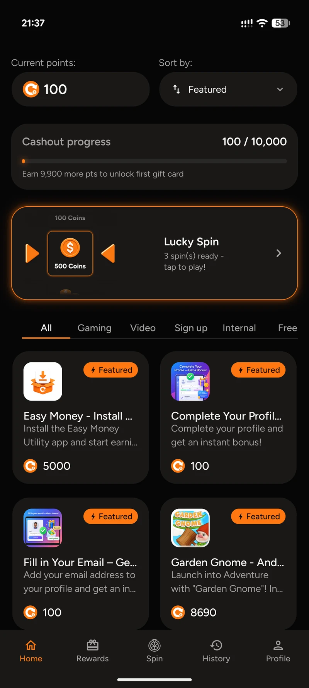
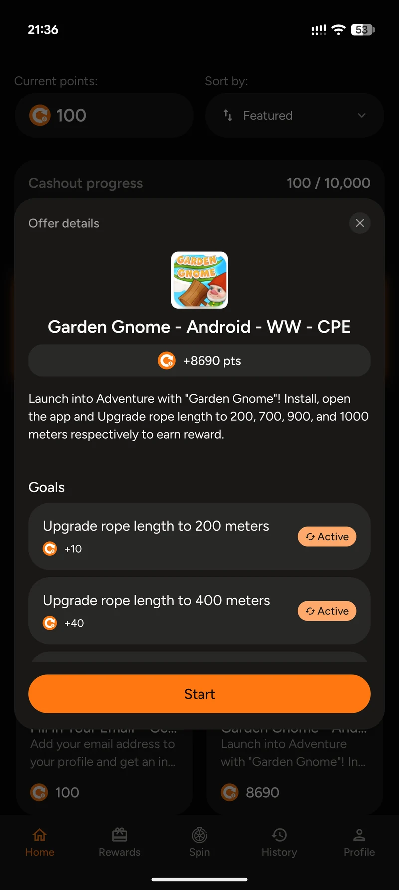
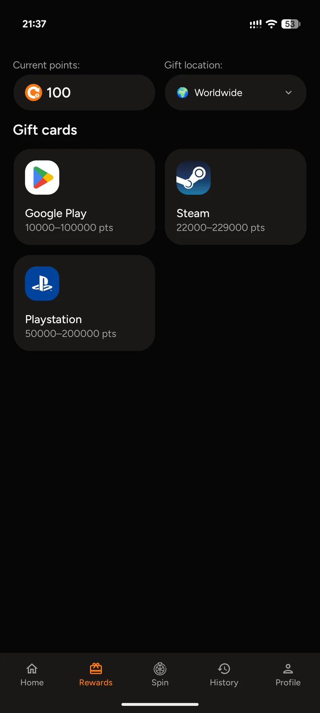

# ClickMoney — Android engineering case study

Native Android offerwall application with offer discovery, goal-based rewards, gift-card flows, and in-app APK updates.

**[Full case study ↗](https://byfedin.dev/clickmoney) · [Watch the 21-second demo ↗](https://byfedin.dev/clickmoney#demo-title)**

## My contribution

**Full Android development · Galaksion’s internal mobile studio**

I owned the Android implementation: architecture, Compose screens, API integrations, session handling, product analytics, and APK delivery. The app integrates with backend services for offers, account data, and reward operations.

**Platform:** Android  
**Delivery:** APK distribution  
**Stack:** Kotlin · Jetpack Compose · Coroutines & Flow · Hilt · Retrofit / OkHttp · DataStore · AppMetrica

## The application

- A paginated offer catalog with category and sort controls.
- Offer details and individual completion goals in a native bottom sheet.
- Account/session handling, point balance, and gift-card reward flows.
- Product analytics and the lifecycle of delivering and updating an APK.

<table>
<tr>
<td align="center"> Offer discovery</td>
<td align="center"> Goals & offer details</td>
<td align="center"> Rewards catalog</td>
</tr>
</table>

Actual app captures from a Pixel 9 Pro XL. Open the full case study for larger screenshots and the device walkthrough.

## Engineering work

### Catalog state and asynchronous requests

The catalog uses a ViewModel, StateFlow, cancellable jobs, and request-generation tracking to manage overlapping filter, sort, refresh, and pagination requests. The aim is to keep loading and stale responses consistent with the current selection.

### APK update lifecycle

Distribution outside Google Play requires an app-managed update flow. The implementation supports optional and mandatory updates, resumable HTTPS downloads, size and SHA-256 verification, package/version checks, and installation through Android’s system confirmation.

### Product analytics

Events distinguish opening offer details, requesting a link, handing it off to another app, and returning. Balance increases are measured separately from completion of a specific offer.

### Reliability

Presentation, domain, and data responsibilities are separated with shared result/error types. Unit tests cover download handling, update decisions, installer statuses, offer-return tracking, and notification permission handling.

## About this repository

This repository is a public project showcase with screenshots and an engineering case study. The commercial application’s source code is proprietary and is not included here.

Built by **[Evgenii Fedin](https://byfedin.dev)** · [GitHub](https://github.com/DivisionCom) · [Contact](mailto:evgenii@byfedin.dev)
